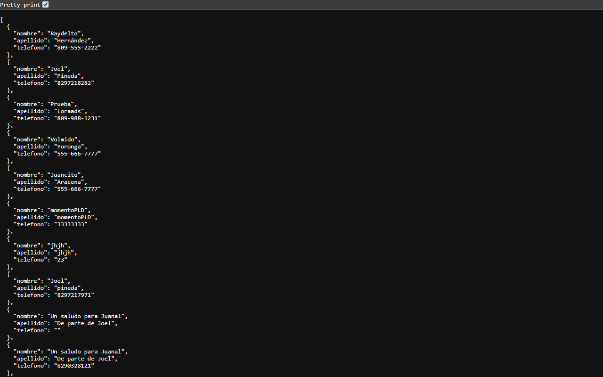
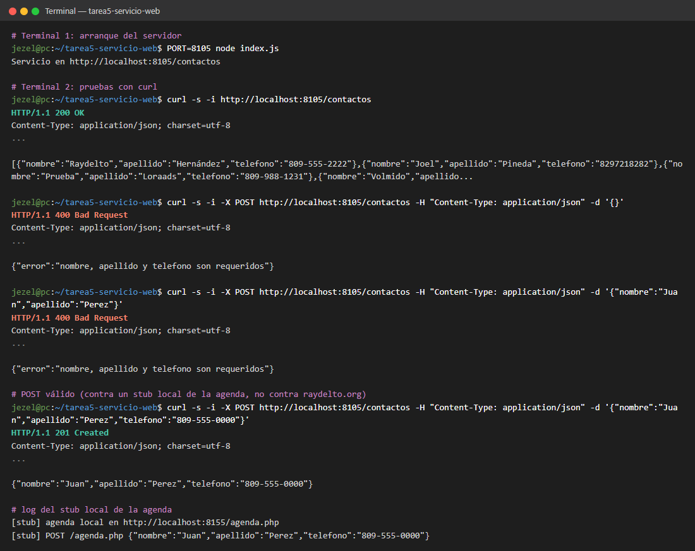

# Tarea 5: Servicio Web

Programación WEB – ITLA (2026-C-003)

Servicio web con Express (Node.js) que lista y almacena contactos usando el servicio `http://www.raydelto.org/agenda.php`.

```bash
npm install
npm start
```

| Método | Ruta         | Descripción                                          |
|--------|--------------|------------------------------------------------------|
| GET    | `/contactos` | Lista todos los contactos                            |
| POST   | `/contactos` | Guarda un contacto `{ nombre, apellido, telefono }`  |

Ejemplo:

```bash
curl -X POST http://localhost:3000/contactos -H "Content-Type: application/json" -d '{"nombre":"Juan","apellido":"Perez","telefono":"809-555-0000"}'
```

## Capturas de pantalla



El navegador abriendo `http://localhost:8105/contactos` (servidor arrancado con `PORT=8105`): el servicio devuelve en JSON los contactos reales obtenidos de la agenda de raydelto.org.



Salida real de la terminal: arranque del servidor, `GET /contactos` (200, JSON recortado con "..."), dos `POST` inválidos (cuerpo vacío y sin `telefono`) que responden 400, y un `POST` válido que responde 201. El POST válido se hizo contra un stub local de la agenda, para no escribir datos de prueba en la agenda pública compartida.
